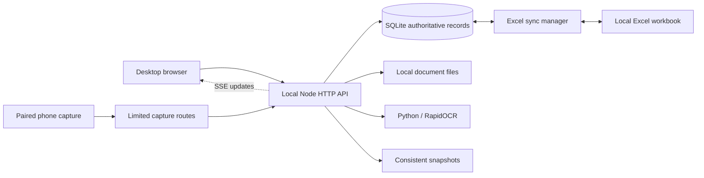

# Architecture and data lifecycle

## Startup and storage

`server.js` initializes the sync manager. If no runtime seed exists, the fictional committed example is copied from `examples/demo-data.js` to `data/mock-data.js`. SQLite is initialized from the runtime seed when needed. App saves update SQLite and the ignored runtime mirror; they do not change the example file.

`db_manager.js` holds records, metadata, activity history and payment-proof registrations. The app remembers what the server last confirmed and sends only the records that changed since then (`POST /api/data/changes`: added or edited records, removed IDs, and settings when they changed). The whole set (`POST /api/data`) is sent only when there is nothing to compare against, such as the first save after starting without the server. Both paths validate IDs and numeric fields, apply changes in one transaction, and keep a record that another window, the phone or an import saved after this window loaded it. Unchanged records avoid repeated audit entries. `data/mock-data.js` is refreshed together with the delayed Excel export.

`sync_manager.js` manages the local workbook and change notifications. Excel may temporarily lock its file while application data remains saved to SQLite. Review sync status and close Excel before retrying a blocked export.

## Browser code

`js/app.js` holds the app's core: start-up, saving, shared helpers and the main render loop. Each screen's functions live in their own file under `js/app/` (for example `orders.js`, `payments.js`, `invoice-studio.js`, `partners.js`) and are added to the same `TradeFlowApp` class with `TradeFlowApp.addMethods`, which refuses a name that is defined twice. `index.html` loads `js/app.js` first, then the screen files; the app starts once the page has loaded. Shared pieces sit beside them in `js/` (`partner-ui.js`, `shell.js`, `smart.js`, `lazy-modals.js`, `components.js`).

## Documents and OCR

Documents remain local under `data/`. The API constrains supported types and resolves access inside the data directory. Smart Fill stages extracted values for review. The optional Python environment is built from locked requirements; image/page dimensions, PDF page count and subprocess time are bounded.

## Backup and recovery

Database snapshots use SQLite-consistent operations that include committed WAL data. Restore creates a safety checkpoint and reports database errors. JSON recovery includes the payment-proof registry.

Keep an external backup of the entire `data/` directory. JSON/database snapshots preserve structured records, while order/partner attachments also need their files. Stop the server before manually replacing a complete data directory; preserve its coherent database files and document layout.

## Security boundaries

Desktop routes are local-only. Other devices are limited to capture resources and token-based uploads. Origin/host validation restricts hostile browser requests; local users and software with access to the Windows account remain trusted. Owner/Operator does not create an authenticated user boundary. See [SECURITY.md](../SECURITY.md).
